<div align="center">

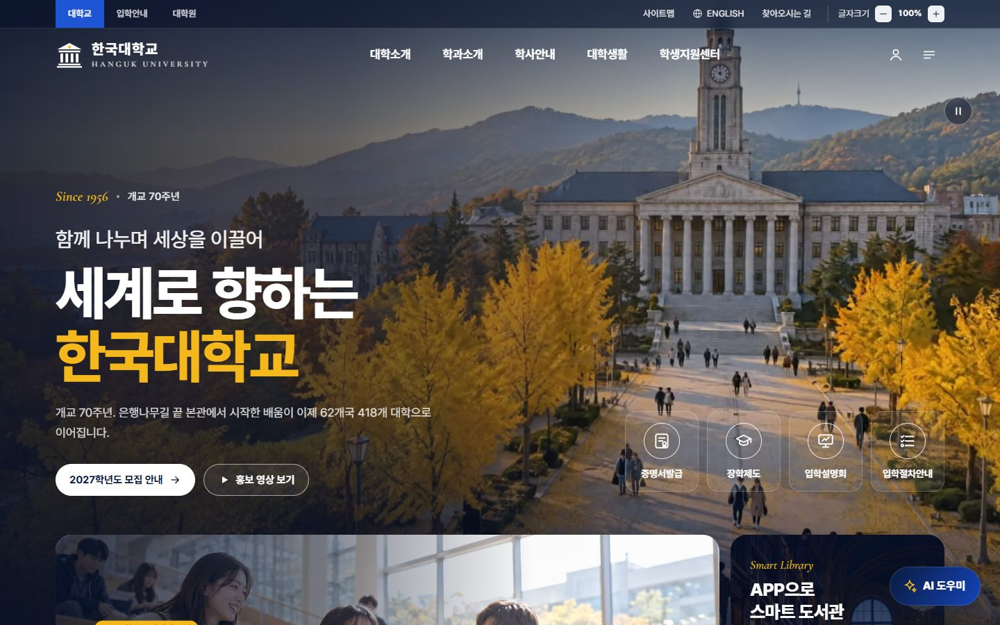

# 한국대학교 — Remastered

**2020년, 처음 만든 jQuery 대학교 메인페이지를 2026년의 도구로 처음부터 다시 지었습니다.**

개교 70주년을 맞은 가상의 대학 · 은행나무길 끝 시계탑 본관 · 사계절 · AI 도우미


**[tjsrjs8282.github.io/hankuk](https://tjsrjs8282.github.io/hankuk/)** · [English](https://tjsrjs8282.github.io/hankuk/en/) · [2020 원본](https://tjsrjs8282.github.io/hankuk/legacy/index.html)

</div>

---

## Before → After

| | 2020 (원본) | 2026 (리마스터) |
|---|---|---|
| 스택 | HTML + jQuery 3.1 + bxSlider + Colorbox | Astro 7 · TypeScript · GSAP · Lenis — 런타임 의존성 넷 |
| 이미지 | 스톡 사진 · 2.4 MB 배경 JPG · PNG 아이콘 22장 | Higgsfield로 만든 사진 16장 → AVIF/WebP · 반응형 srcset · 아이콘은 SVG 한 벌 |
| 영상 | 다른 사람의 유튜브 브이로그를 Colorbox로 | 히어로 루프(Kling 3.0, 2.2 MB VP9) + 직접 만든 30초 캠퍼스 필름(Kling 3.0 + ElevenLabs Music) |
| 슬라이더 | 같은 슬라이드를 4번 복사 | 이야기 4편 · 자동재생 진행바 · 일시정지 · 스와이프 · 키보드 |
| 정보 | "2020년 신˙편입생 2차 모집", 2016년 공지 | 2027학년도 모집 D-day · 2026-27 학사일정 · 개교 70주년 |
| 버튼 | 글자크기 ±, ENGLISH, 사이트맵 — 모두 장식 | 글자크기 90–130% 저장 · 영어 페이지 · 사이트맵/메가메뉴 · 모든 링크가 동작 |
| 폰트 | 시스템 폰트 | Pretendard를 이 사이트가 쓰는 글자만 남겨 89 KB 한 파일로 |
| 접근성 | alt 없음, div 클릭 | 랜드마크 · 탭/캐러셀 ARIA · 네이티브 dialog · 포커스 관리 · 모션 줄이기 |
| Lighthouse | — | **데스크톱 Perf 99 · A11y 100 · BP 100 · SEO 100**<br>모바일(느린 4G 시뮬레이션) Perf 80–83 · A11y 100 · BP 100 · SEO 100 |

<table>
  <tr>
    <td width="50%">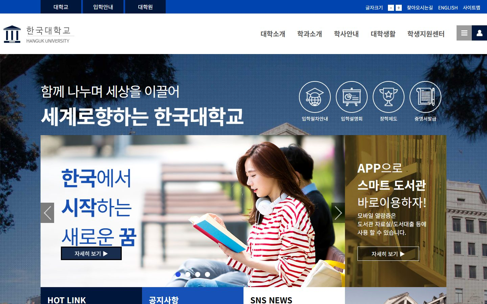<br><sub>2020 · 첫 화면</sub></td>
    <td width="50%"><br><sub>2026 · 히어로 루프 위의 같은 문구 · 같은 네 개의 바로가기</sub></td>
  </tr>
  <tr>
    <td>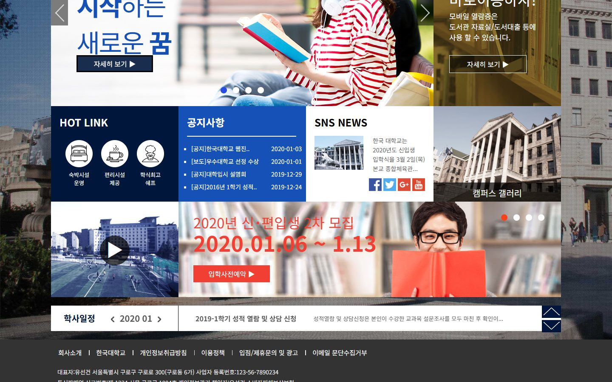<br><sub>2020 · 8칸 카드 (75/25 · 25×4 · 25/75)</sub></td>
    <td>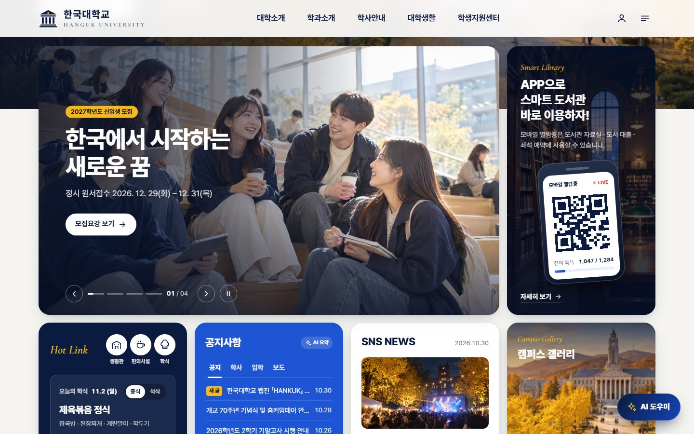<br><sub>2026 · 같은 순서 · 같은 비율, 칸마다 새로</sub></td>
  </tr>
</table>

원본은 [`legacy/`](legacy)에 손대지 않고 보존했고, 배포본에서도 [`/hankuk/legacy/`](https://tjsrjs8282.github.io/hankuk/legacy/index.html)로 그대로 열립니다.

---

## 무엇이 있나

2020년 페이지의 칸을 하나도 버리지 않고, 칸마다 그때 하고 싶었던 일을 실제로 하게 만들었습니다.

| 2020 | 2026 |
|---|---|
| 배경 사진 + "함께 나누며 세상을 이끌어 / 세계로 향하는 한국대학교" | 은행나무길을 따라 본관으로 다가가는 드론 루프(끊김 없이 8.5초) — 문구는 그대로 |
| 증명서발급 · 장학제도 · 입학설명회 · 입학절차안내 동그라미 4개 | 유리 바로가기 4개 → 누르면 **AI 도우미**가 그 주제로 바로 답함 |
| "한국에서 시작하는 새로운 꿈" 슬라이더(같은 장 4번) | 신입생 모집 · 글로벌 캠퍼스 · AI융합대학 신설 · 24시간 도서관, 4편 |
| APP으로 스마트 도서관 | 폰 안의 모바일 열람증 · 시간대에 따라 바뀌는 열람실 잔여 좌석 |
| HOT LINK (숙박시설 · 편리시설 · 학식최고 쉐프) | 생활관 · 편의시설 · 학식 바로가기 + **오늘의 학식**(한국 시간 요일 기준, 중식/석식, 천원의 아침밥) |
| 공지사항 4줄 | 공지 · 학사 · 입학 · 보도 탭(←/→ 키보드) · 3일 안의 글은 '새 글' · 누르면 AI 요약 |
| SNS NEWS (페이스북 · 트위터 · 구글+ · 유튜브) | 가을 축제 「한빛제」 소식 · 인스타그램 · 유튜브 · 카카오톡 · 네이버 블로그 |
| 캠퍼스 갤러리 — 마우스를 올리면 판이 올라옴 | 같은 동작 그대로 → **사계절 본관** 섹션으로 |
| 유튜브 영상 + 재생 버튼 | 직접 만든 30초 캠퍼스 필름(포스터와 영상은 열 때만 받음) |
| 2020년 신˙편입생 2차 모집 · 책 든 학생 | 2027학년도 신·편입생 모집 · 정시까지 **D-day** · 새로 만든 책 든 학생 컷아웃 |
| 학사일정 "2020 01 ‹ ›" · 성적 열람 세로 슬라이더 | 2026. 9 – 2027. 3 **월간 달력**(오늘 표시 · 종류별 점 · 그 달 일정 목록) + 학사 알림 티커 |
| 상단 '찾아오시는길' (링크 없음) | 일러스트 **캠퍼스 맵**(건물 11곳 핀) + 지하철 · 셔틀 · 버스 안내 |
| — | **사계절, 같은 자리의 본관** — 같은 시점의 봄 · 여름 · 가을 · 겨울을 드래그로 넘기는 크로스페이드 |
| — | 총장 인사말 + 숫자로 보는 한국대(처음 볼 때 숫자가 올라감) · 8개 단과대학 32개 학과(펼치기) |
| — | **AI 도우미** — 입학 · 학사 · 장학 · 생활관 · 학식 · 도서관 · 교환학생 · 오시는 길 |
| — | 영어 페이지(`/en/`) · 글자크기 저장 · 사이트맵/전체메뉴 · 2020 원본 링크 |

<table>
  <tr>
    <td width="50%">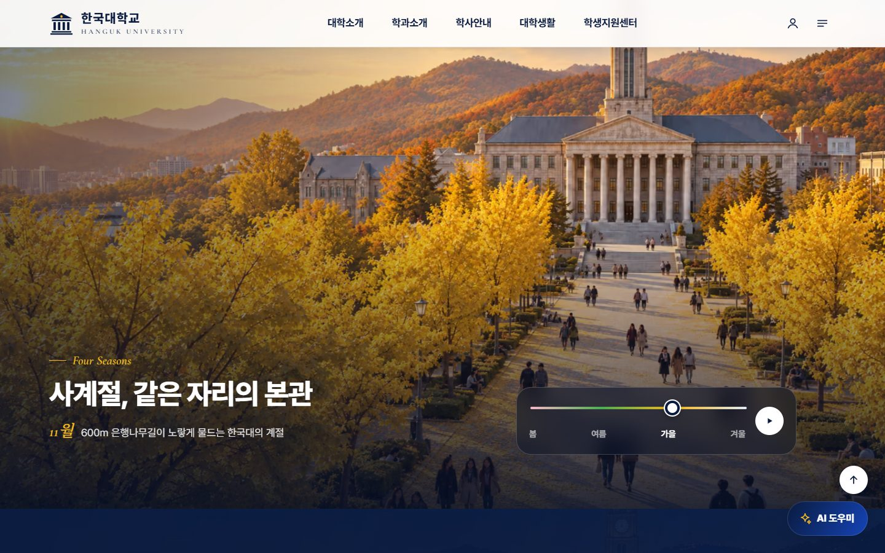</td>
    <td width="50%">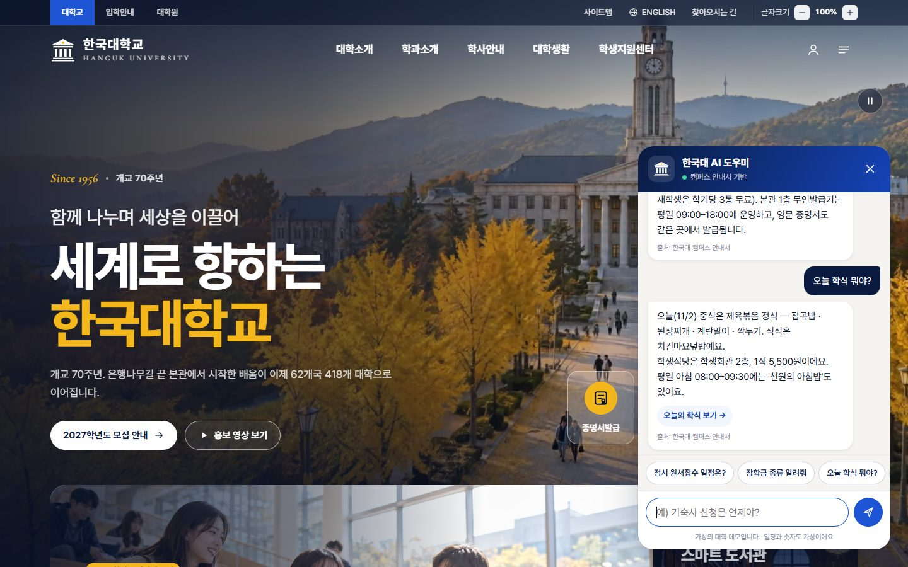</td>
  </tr>
  <tr>
    <td>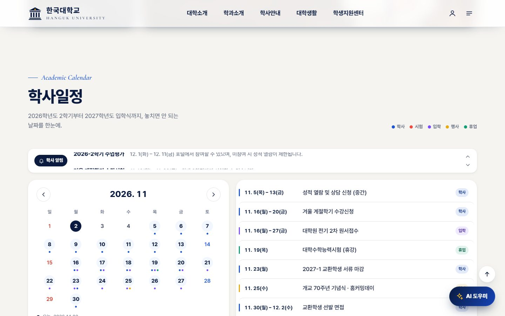</td>
    <td>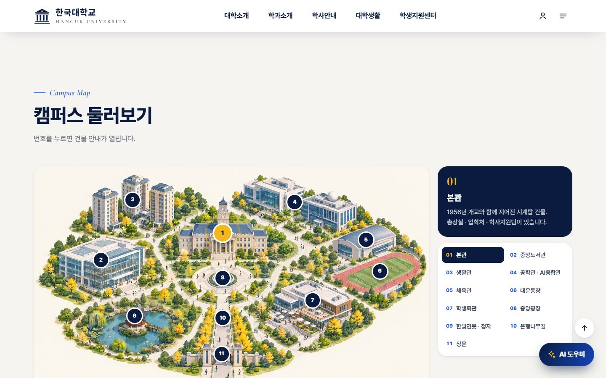</td>
  </tr>
  <tr>
    <td>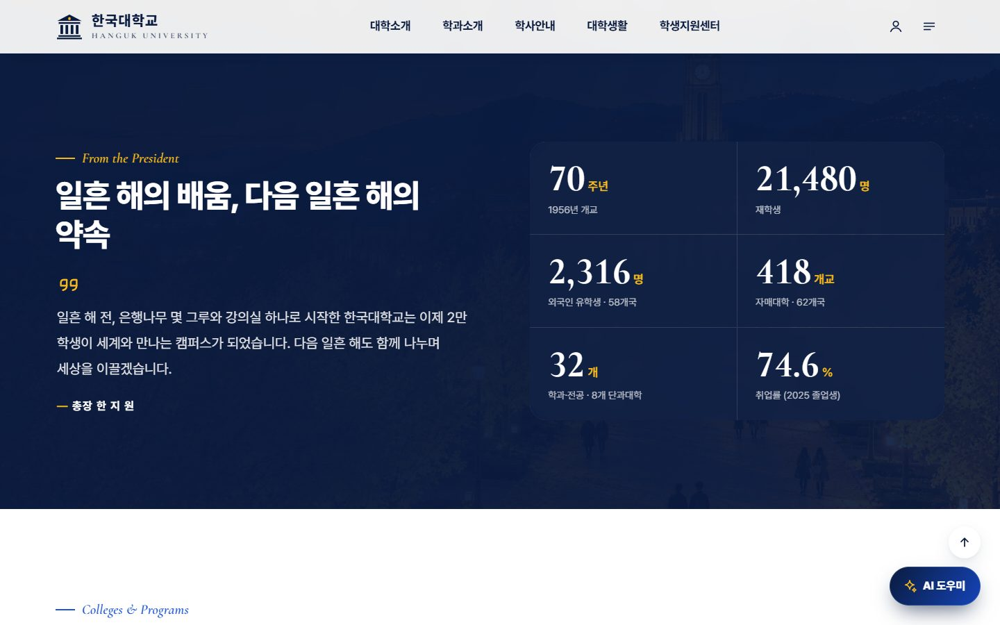</td>
    <td>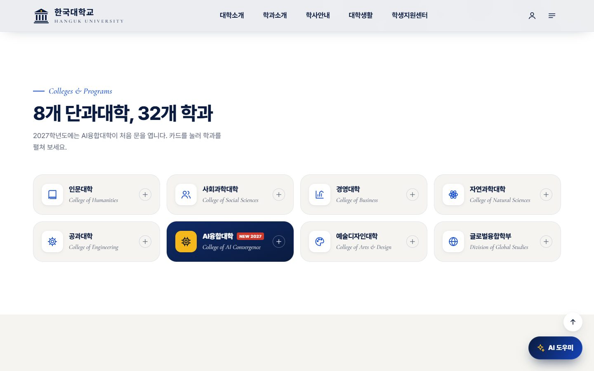</td>
  </tr>
</table>

<p align="center">
  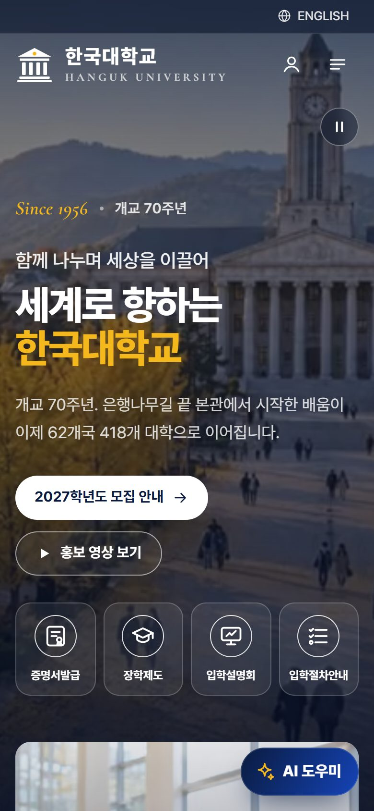
  &nbsp;
  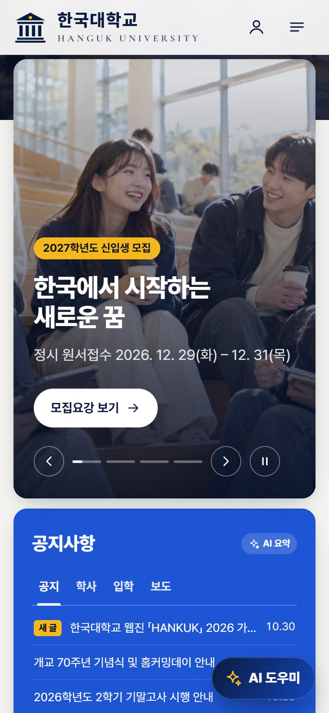
  &nbsp;
  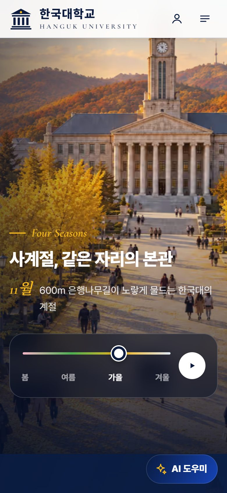
</p>

---

## AI 도우미

한 군데의 안내서([`src/data/guide.ts`](src/data/guide.ts), 주제 26개 · 한/영)가 두 가지 모드를 함께 먹입니다.

- **GitHub Pages** — 서버 없이 브라우저에서 답합니다. 한글 키워드는 부분 일치(조사 무관), 영어는 단어 단위로 맞춰("this"가 "hi"에 걸리지 않게) 가장 맞는 주제를 고르고, `{dday}` · `{menu}`는 한국 시간 기준으로 그 자리에서 채웁니다. 공지 16건을 눌렀을 때 한국어 · 영어 모두 알맞은 주제로 답하는 것을 빌드본에서 확인했습니다.
- **Vercel 빌드** — 같은 안내서와 학사일정 · 오늘의 학식을 Gemini 3.5 Flash Lite의 사실로 넣어 답합니다(`/api/assistant`). 키는 서버에만, Origin 검사 · IP당 10분 12회 · 18초 타임아웃, 실패하면 브라우저 안내서로 조용히 돌아갑니다. "서울대 정시 일정"처럼 다른 대학을 물으면 정중히 거절하고 한국대 일정으로 안내합니다.

답에는 출처 한 줄과 바로가기(학사일정 열기 · 캠퍼스 맵 등)가 붙고, 답은 모두 `textContent`로만 그려 모델 출력이 HTML이 될 일이 없습니다. 2020년의 장식 링크(로그인 · SNS · 약관)는 누르면 "가상의 대학이라 실제 계정은 없다"고 솔직하게 알려 줍니다.

---

## AI · 미디어 파이프라인

에셋은 손으로 만지지 않았습니다. 생성 기록은 [`scripts/assets.json`](scripts/assets.json)에 잡 ID · 모델 · 설정 · 프롬프트까지 남겨 두어, 어느 것이든 다시 뽑아 바꿔 끼울 수 있습니다.

| 단계 | 도구 | 하는 일 |
|---|---|---|
| 사진 16장 | **Higgsfield** · GPT Image 2.5 (2K, high) | 히어로 본관 2컷 · 슬라이드 4 · 도서관 · 열람실 파노라마 · 가을 축제 · 일러스트 캠퍼스 맵 · 책 든 학생(투명 배경) · 사계절 5컷 |
| 사계절 정렬 | GPT Image 2.5 참조 이미지 | 봄 · 여름 · 겨울 · 밤을 히어로를 참조해 만들고, 가을은 **여름 컷을 참조**해 다시 뽑아 네 장의 본관 위치를 맞춤 → 크로스페이드가 타임랩스처럼 보임 |
| 영상 7개 | **Higgsfield** · Kling 3.0 Pro (start frame) | 10초 드론 돌리(히어로) + 5초 클립 6개(은행나무길 · 친구들 · 계단 · AI 연구실 · 황혼의 도서관 · 축제) |
| 음악 | **ElevenLabs Music** `music_v2_5` | 120 BPM · D장조 30초 — 컷 위치(2마디마다)에 맞춘 작곡 계획(인트로 → 빌드 → 리프트 → 마무리 화음) · [`scripts/music.mjs`](scripts/music.mjs) |
| 편집 | FFmpeg · [`scripts/media.mjs`](scripts/media.mjs) | 히어로: 끝 1.5초를 처음에 겹쳐 끊김 없는 8.5초 루프(VP9 1080p · H.264 720p · 480p). 필름: 박자 격자 위 0.5초 디졸브, 엔드카드, 라우드니스 −16 LUFS |
| 사진 손질 | sharp · [`scripts/images.mjs`](scripts/images.mjs) | 원본 PNG → 고품질 소스 JPG, 학생 컷아웃은 투명 여백을 잘라 PNG로 — 크기별 AVIF/WebP는 Astro가 빌드 때 생성 |
| 브랜드 | Chrome(puppeteer) · [`scripts/og.mjs`](scripts/og.mjs) | 2020 로고의 기둥을 SVG로 다시 그리고(금색 빛 한 점), 소셜 카드 · 엔드카드 · 아이콘을 사이트 폰트로 렌더 |
| 폰트 | subset-font · [`scripts/font.mjs`](scripts/font.mjs) | Astro가 시작할 때 `src/`의 글자만 모아 Pretendard 가변(400–800) 한 파일로 — 17조각 455 KB → 89 KB |
| 스크린샷 | puppeteer · [`scripts/shots.mjs`](scripts/shots.mjs) | 이 README의 화면 — 2020 원본과 2026 빌드를 같은 크기로 |

Higgsfield 사용량은 사진 · 영상 전부 합쳐 185.5 크레딧이었습니다.

---

## 구조

```
src/
├─ pages/            index.astro (한국어) · en/index.astro — 둘 다 components/Home.astro
├─ components/       Header · Hero · Highlights(8칸: Stories · LibraryApp · HotLink · Notices · Sns
│                    · GalleryTile · FilmTile · Admission) · Academic · Seasons · About · Colleges
│                    · Campus · Footer · Sitemap · FilmDialog · Assistant · Icon · Logo …
├─ data/             site.ts (모든 문구 · 일정 · 학식 · 학과 · 지도 핀, 한/영) · guide.ts (AI 도우미)
├─ lib/              cal.ts (서버 렌더와 브라우저가 같이 쓰는 달력 계산) · paths.ts
├─ scripts/          app.ts (진입점) · hero · slider · tabs · dining · live · calendar · ticker
│                    · seasons · map · dialogs · assistant(+engine) · fontsize · header · motion(GSAP·Lenis, 지연 로드)
├─ server/           assistant.ts (Gemini — Vercel 빌드에서만)
└─ styles/global.css 디자인 토큰(2020 팔레트 #00163b · #0044af · #f13f33 + 은행잎 금색)
scripts/             위 에셋 파이프라인 · assets.json(생성 기록)
legacy/              2020년 원본 그대로
```

**설계 메모**

- 2020년 그리드(75/25 · 25×4 · 25/75)와 칸의 순서, 히어로에 걸쳐 올라오는 배치를 그대로 지켰습니다. 무엇이 무엇이 되었는지 한눈에 대응되도록.
- 정적 HTML + 점진적 향상. JS가 없어도 모든 내용이 보이고, 위젯 하나가 실패해도 나머지는 동작합니다(`app.ts`가 하나씩 감싸 실행). 오늘 날짜에 따라 바뀌는 것(D-day · 새 글 · 학식 · 달력 · 좌석)은 한국 시간 기준.
- 히어로는 고해상도 정지 사진이 먼저 서고(AVIF preload), 루프는 페이지가 다 뜬 뒤 그 위로 1.4초에 걸쳐 스며듭니다. 화면 밖이면 멈추고, 모션 줄이기 · 데이터 절약 · 2G에서는 받지 않습니다.
- `prefers-reduced-motion`이면 Lenis · 패럴랙스 · 자동재생(슬라이더 · 티커 · 사계절)이 모두 꺼집니다. 자동으로 움직이는 것에는 전부 일시정지 버튼이 있습니다.
- 글자크기는 루트 크기를 바꿔 레이아웃이 함께 커지고, 첫 페인트 전에 복원되어 깜빡이지 않습니다.
- CSS(약 70 KB)는 HTML에 들어가 렌더를 막는 요청이 없습니다. AI 도우미를 열 때만 전체 Pretendard 조각 CSS를 `<link>`로 붙입니다(`import()`로 하면 Astro가 페이지 CSS로 끌어올리기 때문).

---

## 시작하기

```bash
npm install
cp .env.example .env.local   # GEMINI_API_KEY · ELEVENLABS_API_KEY (둘 다 선택)
npm run dev                  # http://localhost:4350/hankuk/
```

| 명령 | |
|---|---|
| `npm run dev` | 개발 서버 (GitHub Pages 모드 — AI 도우미는 안내서로 답함) |
| `npm run dev:vercel` | Vercel 모드 개발 서버 — `/api/assistant`(Gemini) 포함 |
| `npm run build` / `npm run preview` | `/hankuk` 아래 정적 빌드 → `dist/` (2020 원본은 `dist/legacy/`) |
| `npm run build:vercel` | 도메인 루트 + Gemini 함수 → `.vercel/output` |
| `npm run check` | 타입 검사 |
| `npm run assets:fetch` → `assets:images` | 생성 기록의 원본을 받아 `src/assets/photos`로 |
| `npm run assets:music` | ElevenLabs로 필름 음악 생성 (`ELEVENLABS_API_KEY`) |
| `npm run assets:og` → `assets:media` | 소셜 카드 · 엔드카드 렌더 → 히어로 루프 · 캠퍼스 필름 인코딩 (FFmpeg 필요) |
| `npm run shots` | README 스크린샷 (`npm run preview`를 켠 상태에서) |

## 배포

- **GitHub Pages** — `master`에 푸시하면 [`.github/workflows/deploy.yml`](.github/workflows/deploy.yml)이 검사 → 빌드 → 배포합니다. 저장소 설정에서 Pages 소스를 한 번 **GitHub Actions**로 바꿔야 합니다(원본은 브랜치 루트에서 바로 서빙하던 방식).
- **Vercel** (선택) — 저장소를 연결하면 `VERCEL` 환경에서 자동으로 도메인 루트 + `/api/assistant` 빌드가 됩니다. `GEMINI_API_KEY`를 환경 변수로 넣으면 AI 도우미가 Gemini로 답합니다.

---

<sub>한국대학교는 실제로 존재하지 않는 가상의 대학이며, 사진 · 영상 · 음악은 모두 AI로 생성했습니다. 일정 · 숫자 · 인물도 가상입니다(대학수학능력시험일 2026. 11. 19.만 실제). 2020 원본 디자인 · 개발, 2026 리마스터 — 유선건.</sub>
